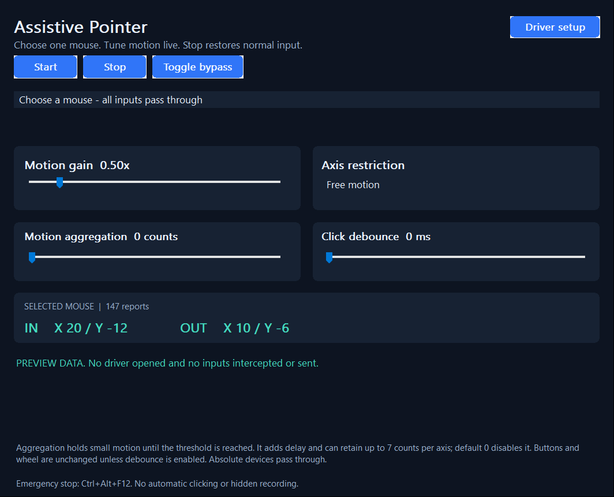

# Assistive Pointer

<!-- full-version-contact:start -->
> [!IMPORTANT]
> **Get the version without the one-hour demo limit**
>
> **Discord · `titancsa`**. Open [Discord](https://discord.com/app), choose **Friends → Add Friend**, enter **`titancsa`** and send a message.
> Mention **Assistive-Pointer** and ask for the full **Interceptor Keyboard & Mouse** driver. TitanCSA will share the purchase details privately.
>
> **FR · Version sans la limite d’une heure.** Ajoute **`titancsa`** sur Discord et envoie le nom du projet. Le lien d’achat est communiqué en privé.
<!-- full-version-contact:end -->

**Simple motion adjustments for one selected mouse on Windows 10/11 x64.** Tune gain, restrict motion to an axis, and optionally reduce small movements or repeated clicks through [Interceptor Keyboard & Mouse](https://github.com/TitanCSA/Interceptor-Keyboard-Mouse).



Changes happen in the input path. Other mice and keyboard input pass through unchanged. No automatic clicks, background recording or network input service is started.

## Install and use

1. Extract the application ZIP from [Releases](https://github.com/titanfyre/Assistive-Pointer/releases/latest).
2. Open `Dependencies/InterceptorSetup.exe`, choose **Install / reinstall**, and restart Windows if requested. The driver is Microsoft-signed; signing alone does not certify compatibility with every system.
3. Open `AssistivePointer.exe` and choose **Start**. Accept the administrator prompt needed to access the driver.
4. Move the mouse you want to adjust, then select its source in the device menu. Until a specific source is selected, **all inputs remain unchanged**.
5. Adjust the controls live. **Toggle bypass** forwards unchanged input. **Stop**, closing the window, or **Ctrl+Alt+F12** releases capture and restores normal passthrough.

| Control | Behavior |
|---|---|
| Motion gain | 0.05x to 4.00x relative motion; fractional counts are carried forward rather than rounded away on every report. |
| Axis restriction | Free motion, horizontal only, or vertical only. |
| Motion aggregation | Disabled at 0. With a threshold of 1..8 counts, small movements accumulate until the threshold is reached. **This adds motion delay** and can retain up to 7 whole counts per axis while stopped. |
| Click debounce | Disabled at 0. Otherwise suppresses a repeated same-button press within the chosen 1..250 ms interval, together with its matching release. Wheel fields and motion are preserved. |

Buttons, side buttons and wheel are unchanged with debounce disabled. Absolute-coordinate reports, including tablets, pass through. Axis restriction deliberately discards motion on the locked axis. Changing the selected mouse or toggling bypass clears the filter's small accumulated remainder. The app is a usability tool, not a medical treatment or a guarantee that every form of tremor will improve.

Device discovery reads the active capture snapshot every 500 ms; each transformed report must still match the exact selected capture-scoped token. A new capture starts with no mouse selected; reconnect a device and explicitly select it again if needed. UI refresh is separate from input forwarding; it does not impose a 10 Hz input-processing limit.

## Demo and production licenses

The matching Interceptor-Keyboard-Mouse demo driver source is available; see
[driver/README.md](driver/README.md) for build instructions and separate
evaluation-source terms. Those terms apply to Titan-authored driver code. Third-party
source licenses and existing application/SDK licenses remain applicable. Full/commercial
implementation and private signing or activation material are excluded.

Every application feature and its user-mode source are available. The driver is a **one-hour demo**, counted from the first capture after Windows starts and shared across applications using that driver. At expiry it returns to passthrough. Windows **Restart** starts another evaluation period.

For the production driver without the demo timer, company deployment, OEM integration or support: in Discord, choose **Friends -> Add Friend**, enter **`titancsa`**, and mention **Assistive Pointer**. The production driver's commercial terms are separate from this application's MIT source license. No customer activation key or full/commercial kernel implementation is included.

## Build and verify

Use Visual Studio 2022 with Desktop development with C++, a Windows SDK and CMake:

```powershell
./Build.ps1
./bin/AssistivePointer.exe --self-test
```

The C++17 build enables `/W4 /WX`. Offline fixtures exercise positive/negative fractional motion, extremes, axis locks, thresholds, matching button releases, absolute-report preservation and 100,000 mixed-motion iterations. `--preview` uses labelled fixture data. `--render-preview` writes `bin/Preview.bmp` and exits. No driver is opened and no input is intercepted or sent by these modes.

`SDK/Interceptor.cpp` and `SDK/Interceptor.h` are unchanged demo SDK files. Authorized production builds can select the matching licensed SDK:

```powershell
cmake -S . -B obj/production -A x64 -DSDK_DIRECTORY="D:/YourLicensedKeyboardMouseSDK"
cmake --build obj/production --config Release
```

Install and activate its corresponding production driver separately with the supplied tools. `Samples/` documents example control values; the app keeps settings in memory and does not import these files.

## License and responsible use

The application and SDK user-mode sources use the MIT license; see `LICENSE` and `SDK/LICENSE`. Bundled driver binaries use `Dependencies/BINARY-LICENSE.txt`. Use the software only on systems you are authorized to control. You remain responsible for your actions and applicable rules. No warranty or promise of universal compatibility is provided, and liability is limited subject to applicable law.

## Commercial integration and support


